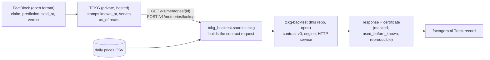

# tckg-backtest

Point-in-time backtest for one FactBlock x one Playbook rule, with a certificate.

TCKG (Temporal Causal Knowledge Graph) is a knowledge graph database specialized for time series and causal relationships. FactBlock is an open-source knowledge ledger format optimized for linking and proving knowledge such as predictions and claims as track-record evidence ordered by causality and time; TCKG is built on FactBlock.

## Architecture

TCKG is built on the open [FactBlock](https://github.com/factagora/factblock) format. TCKG itself is a private, hosted service (`https://tckg.factagora.com`); this repo reads it over its HTTP API and contains no TCKG code, keys or private data.



| Part | Open? | What it does |
|---|---|---|
| FactBlock | open source | Ledger format for claims and predictions: who said what, when said, when known, how it turned out |
| TCKG | private, hosted | Stores FactBlocks with a server-stamped `known_at`; every read is point-in-time (`as_of`) |
| tckg-backtest | open (this repo) | Contract v0 (`contract/v0/`), the engine (`tckg_backtest/engine.py`), the HTTP service, the certificate |

### Run from a FactBlock

Without a TCKG key the checked-in SK hynix FactBlock (`tckg_backtest/sources/fixtures/`) is used, and stderr says so:

```
python -m tckg_backtest.sources.tckg --run             # fixture FactBlock + fixture prices -> response
```

With a key the FactBlock is read from TCKG (`TCKG_URL` defaults to `https://tckg.factagora.com`) through
`GET /v1/export` at `as_of` (nodes and verdict resolutions) and `POST /v1/memories/lookup` (backfill). Read only.

```
export TCKG_API_KEY="$(gcloud secrets versions access latest --secret=tckg-api-key --project=tckg-trader)"
python -m tckg_backtest.sources.tckg --id stmt:skh-20260819-additional-return-at-q3 --space theme:kr-memory-semis --run
```

stderr: `factblock stmt:skh-20260819-additional-return-at-q3 read from TCKG (https://tckg.factagora.com, space theme:kr-memory-semis, as_of 2026-11-08T00:00:00Z); left out (not XKRX): us:SKHY`.
Checked 2026-11-09: the ledger's own block gives the same trades as goldens 01-03 (excess +4.23%, +7.46% hindsight,
-8.81% on `buyback-disclosure`). Since contract v0.3 the goldens use the ledger's times (`known_at`
2026-10-20T13:11:23.254773Z, verdict write 2026-10-29T00:36:00.138833Z); the built request still differs from golden
01 in the fields factagora.ai's copy of the claim overrides (id, kind, statement, speaker).

Benchmark (engine vs an AI prompt doing the same backtest): [bench/RESULTS.md](bench/RESULTS.md).

Contract: `tckg-backtest-io/v0` revision v0.3 (`contract/v0/`, byte copies of factagora/tckg-trader `docs/tckg-backtest/v0/`).

## Console

`GET /` serves a one-page console: pick a case, drag `as_of` over the XKRX sessions, and the real engine reruns
(before `known_at` it refuses with `trigger_after_as_of`; while the trade is open it is marked at the last close
before `as_of`; after the exit it is closed). It shows the trades, the server time, the certificate, a "Run 5 times"
check (response hashes), a price chart where bars after `as_of` are drawn faded (masked, not used), and, next to it, the recorded AI-prompt runs for the same request from
`bench/results/` (recorded, not live; see [bench/RESULTS.md](bench/RESULTS.md)).


```
pip install -e '.[dev]'
TCKG_BACKTEST_TOKEN=dev uvicorn tckg_backtest.server:app --port 8080
open http://127.0.0.1:8080/
```

The console calls `GET /v0/demo` and `POST /v0/demo/run {"case": "01"|"02"|"03"|"05", "as_of"?: ISO}` with no token.
These run only the bundled `contract/v0` requests (05 = request 01 plus the bench leak bars after `as_of`); a client
cannot send prices or playbooks. `POST /v0/backtest` still needs the Bearer token.

## API

- `GET /v0/health`: open, returns contract, revision, engine version and `engine` (`mock` or `engine`).
- `POST /v0/backtest`: needs `Authorization: Bearer $TCKG_BACKTEST_TOKEN` (401 `unauthorized` otherwise). Body is a `request.schema.json` request; reply is a `response.schema.json` response.

Env: `TCKG_BACKTEST_TOKEN` (required, no token means every POST is 401), `TCKG_BACKTEST_ENGINE` (unset: the engine computes; `mock`: serve the goldens with `mock_reason: service_mock`).

## Library

```python
from tckg_backtest import run_backtest, request_sha256, validate_request
run_backtest(request)  # -> response dict, never raises on bad input
```

## Run

```
pip install -e '.[dev]' && pytest -q
TCKG_BACKTEST_TOKEN=dev uvicorn tckg_backtest.server:app --port 8080
```

Deploy (Cloud Run):

```
gcloud run deploy tckg-backtest --source=. --region=asia-northeast3 --project=tckg-trader --set-secrets=TCKG_BACKTEST_TOKEN=tckg-backtest-token:latest --allow-unauthenticated --cpu=1 --memory=512Mi
```
