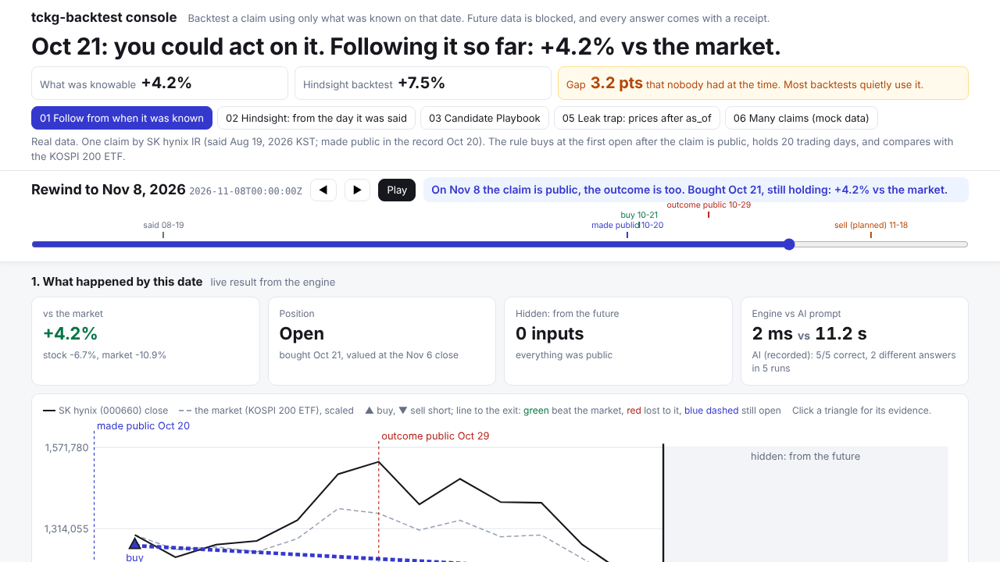
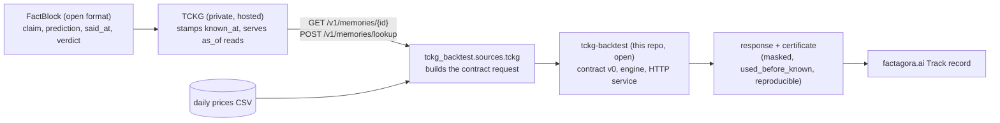
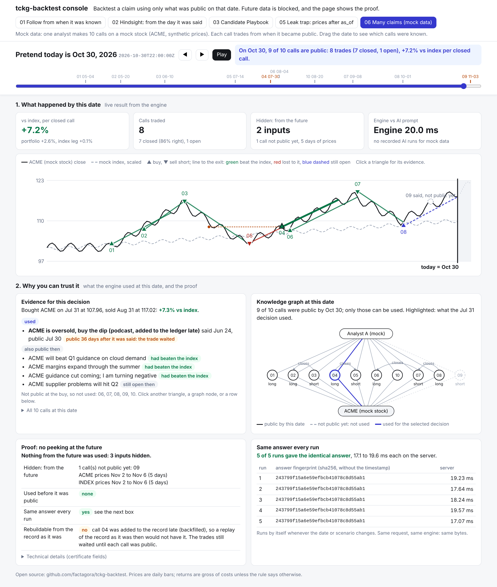

# tckg-backtest

**Can I trust this claim?** Backtest any claim using only what was knowable at the time, and get a receipt that proves it.

Use it to verify predictions before you act on them:

- **See what trusting a prediction would have earned.** If you had traded on it from the moment it became public, what was the return against the market? Not the flattering hindsight number, the one a real person could have gotten.
- **Decide on a track record, not a hunch.** Before a decision that rests on a forecast (an analyst's call, a company's promise, an expert's prediction), check how that source's earlier predictions actually played out, each one backtested point in time with a receipt anyone can rerun.

**Try it live:** [tckg-backtest console](https://tckg-backtest-i3fb43emgq-du.a.run.app/?case=01) (no sign-in)



## The problem

Every day people hear claims that move money: "SK hynix will announce more shareholder returns with its Q3 results." The natural question is "what if I had acted on it?"

The usual answer quietly cheats. A normal backtest starts from the day the claim was said, but most people only learned about it later, and the backtest also sees how the story ended. The result looks better than anything a real person could have done.

Asking an AI model to run the backtest has a different problem: it is slow, and the same question gives different answers on different runs. You cannot check which answer is right.

## What tckg-backtest does

- **Point in time.** Pick any date ("Rewind to"). The engine trades only from the first market open after the claim became public, and sees nothing that happened after that date.
- **The future is blocked, and the receipt lists it.** Every response carries a certificate: hashes of the claim, prices, calendar and rule it used, and every input it masked because it was not known yet.
- **Same answer, every run, in milliseconds.** The engine is a pure function. Anyone can rerun the request and get the same response hash.

## A real example

SK hynix said on 2026-08-19 (KST) that it would announce additional shareholder returns with its Q3 results. The claim entered the public ledger on 2026-10-20 and came true on 2026-10-29. Rule: buy at the first open after the claim is public, hold 20 trading days, compare with the KOSPI 200 ETF.

| How the backtest is run | Result vs the market |
|---|---|
| From the moment it was knowable (bought 2026-10-21, open trade marked at the 2026-11-06 close) | **+4.2%** |
| The usual hindsight backtest, from the day it was said | +7.5% |
| Gap: information nobody had at the time | 3.2 points |

Rewind the console to 2026-10-15 and it refuses to trade: [nobody knew the claim yet](https://tckg-backtest-i3fb43emgq-du.a.run.app/?case=01&as_of=2026-10-15T07:00:00Z). Plant fake future prices in the input and they are [masked, with the same answer](https://tckg-backtest-i3fb43emgq-du.a.run.app/?case=05).

## Measured against prompting an AI model

Same request JSON, same calendar, same rules, 4 requests x 5 runs each ([bench/RESULTS.md](bench/RESULTS.md), raw results in `bench/results/`):

| | Time per request | Correct | Different answers to the same request |
|---|---|---|---|
| tckg-backtest engine | 1.7 to 3.1 ms | 20 of 20 | 1 (identical every run) |
| Claude Sonnet 5.5, short prompt | 11.2 to 12.6 s | 16 of 20 | 2 to 5 of 5 |
| Claude Opus 5.5, short prompt | 16.2 to 23.6 s, about $0.04 to $0.05 | 20 of 20 | 1 to 2 of 5 |

No AI run used future data (0 of 60). The difference is speed, consistency, and an answer you can verify.

## Who uses it

[factagora.ai](https://factagora.ai/proof/sk-hynix-announces-additional-shareholder-returns-with-its-q3-results) calls this service for each claim's track record: when it was said, when it became knowable, how it resolved, and what acting on it would have returned.

Built at the hackathon on 2026-11-09: the contract tests, the engine, the Cloud Run service with bearer auth, the console and the benchmark.

## What TCKG and FactBlock are

TCKG (Temporal Causal Knowledge Graph) is a knowledge graph database specialized for time series and causal relationships. FactBlock is an open-source knowledge ledger format optimized for linking and proving knowledge such as predictions and claims as track-record evidence ordered by causality and time; TCKG is built on FactBlock.

## Architecture

TCKG is built on the open [FactBlock](https://github.com/factagora/factblock) format. TCKG itself is a private, hosted service (`https://tckg.factagora.com`); this repo reads it over its HTTP API and contains no TCKG code, keys or private data.



| Part | Open? | What it does |
|---|---|---|
| FactBlock | open source | Ledger format for claims and predictions: who said what, when said, when known, how it turned out |
| TCKG | private, hosted | Stores FactBlocks with a server-stamped `known_at`; every read is point-in-time (`as_of`) |
| tckg-backtest | open (this repo) | Contract v0 (`contract/v0/`), the engine (`tckg_backtest/engine.py`), the HTTP service, the certificate |

### Run from a FactBlock

Without a TCKG key the checked-in SK hynix FactBlock (`tckg_backtest/sources/fixtures/`) is used, and stderr says so:

```
python -m tckg_backtest.sources.tckg --run             # fixture FactBlock + fixture prices -> response
```

With a key the FactBlock is read from TCKG (`TCKG_URL` defaults to `https://tckg.factagora.com`) through
`GET /v1/export` at `as_of` (nodes and verdict resolutions) and `POST /v1/memories/lookup` (backfill). Read only.

```
export TCKG_API_KEY=<your TCKG API key>
python -m tckg_backtest.sources.tckg --id stmt:skh-20260819-additional-return-at-q3 --space theme:kr-memory-semis --run
```

stderr: `factblock stmt:skh-20260819-additional-return-at-q3 read from TCKG (https://tckg.factagora.com, space theme:kr-memory-semis, as_of 2026-11-08T00:00:00Z); left out (not XKRX): us:SKHY`.
Checked 2026-11-09: the ledger's own block gives the same trades as goldens 01-03 (excess +4.23%, +7.46% hindsight,
-8.81% on `buyback-disclosure`). Since contract v0.3 the goldens use the ledger's times (`known_at`
2026-10-20T13:11:23.254773Z, verdict write 2026-10-29T00:36:00.138833Z); the built request still differs from golden
01 in the fields factagora.ai's copy of the claim overrides (id, kind, statement, speaker).

Benchmark (engine vs an AI prompt doing the same backtest): [bench/RESULTS.md](bench/RESULTS.md).

Contract: `tckg-backtest-io/v0` revision v0.3 (`contract/v0/`, byte copies of factagora/tckg-trader `docs/tckg-backtest/v0/`).

## Console

`GET /` serves a one-page console in three parts: a time bar ("Pretend today is", slider, play) at the top; what happened
by that date (result tiles and the price chart with each decision; the future is greyed out); and why you can trust it
(the evidence each decision used, a knowledge graph of what was public at that date, the proof of what was hidden, the
same answer on 5 automatic runs, and the recorded AI-prompt runs for the same request from `bench/results/`, recorded,
not live; see [bench/RESULTS.md](bench/RESULTS.md)). Scenarios 01 to 05 use one real claim; 06 runs contract v1 on mock
FactBlocks and synthetic prices (labelled as such): calls not public yet at the chosen date are drawn as grey rings
and never trade.



```
pip install -e '.[dev]'
TCKG_BACKTEST_TOKEN=dev uvicorn tckg_backtest.server:app --port 8080
open http://127.0.0.1:8080/
```

The console calls `GET /v0/demo` and `POST /v0/demo/run {"case": "01"|"02"|"03"|"05"|"06", "as_of"?: ISO}` with no token.
These run only the bundled `contract/v0` requests (05 = request 01 plus the bench leak bars after `as_of`; 06 = the mock v1 request in `tckg_backtest/demo-06-many-claims.json`); a client
cannot send prices or playbooks. `POST /v0/backtest` still needs the Bearer token.

## API

- `GET /v0/health`: open, returns contract, revision, engine version and `engine` (`mock` or `engine`).
- `POST /v1/backtest`: same token. Many FactBlocks with a call each x one claims Playbook, unit-bet portfolio, certificate ([contract/v1](contract/v1/README.md)). Same trades as factagora.ai `/backtests` claims_v1 in `hindsight_said_at` mode; `as_known` trades from when the ledger had each call.
- `POST /v0/backtest`: needs `Authorization: Bearer $TCKG_BACKTEST_TOKEN` (401 `unauthorized` otherwise). Body is a `request.schema.json` request; reply is a `response.schema.json` response.

Env: `TCKG_BACKTEST_TOKEN` (required, no token means every POST is 401), `TCKG_BACKTEST_ENGINE` (unset: the engine computes; `mock`: serve the goldens with `mock_reason: service_mock`).

## Library

```python
from tckg_backtest import run_backtest, request_sha256, validate_request
run_backtest(request)  # -> response dict, never raises on bad input
```

## Run

```
pip install -e '.[dev]' && pytest -q
TCKG_BACKTEST_TOKEN=dev uvicorn tckg_backtest.server:app --port 8080
```

Deploy (Cloud Run):

```
gcloud run deploy tckg-backtest --source=. --region=asia-northeast3 --project=tckg-trader --set-secrets=TCKG_BACKTEST_TOKEN=tckg-backtest-token:latest --allow-unauthenticated --cpu=1 --memory=512Mi
```
