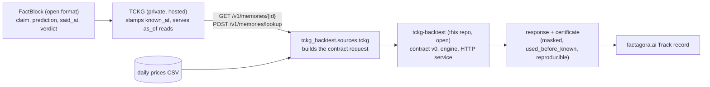

# tckg-backtest

Point-in-time backtest for one FactBlock x one Playbook rule, with a certificate.

TCKG (Temporal Causal Knowledge Graph) is a knowledge graph database specialized for time series and causal relationships. FactBlock is an open-source knowledge ledger format optimized for linking and proving knowledge such as predictions and claims as track-record evidence ordered by causality and time; TCKG is built on FactBlock.

## Architecture

TCKG is built on the open [FactBlock](https://github.com/factagora/factblock) format. TCKG itself is a private, hosted service (`https://tckg.factagora.com`); this repo reads it over its HTTP API and contains no TCKG code, keys or private data.



| Part | Open? | What it does |
|---|---|---|
| FactBlock | open source | Ledger format for claims and predictions: who said what, when said, when known, how it turned out |
| TCKG | private, hosted | Stores FactBlocks with a server-stamped `known_at`; every read is point-in-time (`as_of`) |
| tckg-backtest | open (this repo) | Contract v0 (`contract/v0/`), the engine (`tckg_backtest/engine.py`), the HTTP service, the certificate |

### Run from a FactBlock

Without a TCKG key the checked-in SK hynix FactBlock (`tckg_backtest/sources/fixtures/`) is used, and stderr says so:

```
python -m tckg_backtest.sources.tckg --run             # fixture FactBlock + fixture prices -> response
```

With a key the FactBlock is read from TCKG (`TCKG_URL` defaults to `https://tckg.factagora.com`):

```
TCKG_API_KEY=... python -m tckg_backtest.sources.tckg --id <node id> --space <space> --prices prices.csv --run
```

Benchmark (engine vs an AI prompt doing the same backtest): [bench/RESULTS.md](bench/RESULTS.md).

Contract: `tckg-backtest-io/v0` revision v0.2 (`contract/v0/`, byte copies of factagora/tckg-trader `docs/tckg-backtest/v0/`).

## API

- `GET /v0/health`: open, returns contract, revision, engine version and `engine` (`mock` or `engine`).
- `POST /v0/backtest`: needs `Authorization: Bearer $TCKG_BACKTEST_TOKEN` (401 `unauthorized` otherwise). Body is a `request.schema.json` request; reply is a `response.schema.json` response.

Env: `TCKG_BACKTEST_TOKEN` (required, no token means every POST is 401), `TCKG_BACKTEST_ENGINE` (unset: the engine computes; `mock`: serve the goldens with `mock_reason: service_mock`).

## Library

```python
from tckg_backtest import run_backtest, request_sha256, validate_request
run_backtest(request)  # -> response dict, never raises on bad input
```

## Run

```
pip install -e '.[dev]' && pytest -q
TCKG_BACKTEST_TOKEN=dev uvicorn tckg_backtest.server:app --port 8080
```

Deploy (Cloud Run):

```
gcloud run deploy tckg-backtest --source=. --region=asia-northeast3 --project=tckg-trader --set-secrets=TCKG_BACKTEST_TOKEN=tckg-backtest-token:latest --allow-unauthenticated --cpu=1 --memory=512Mi
```
